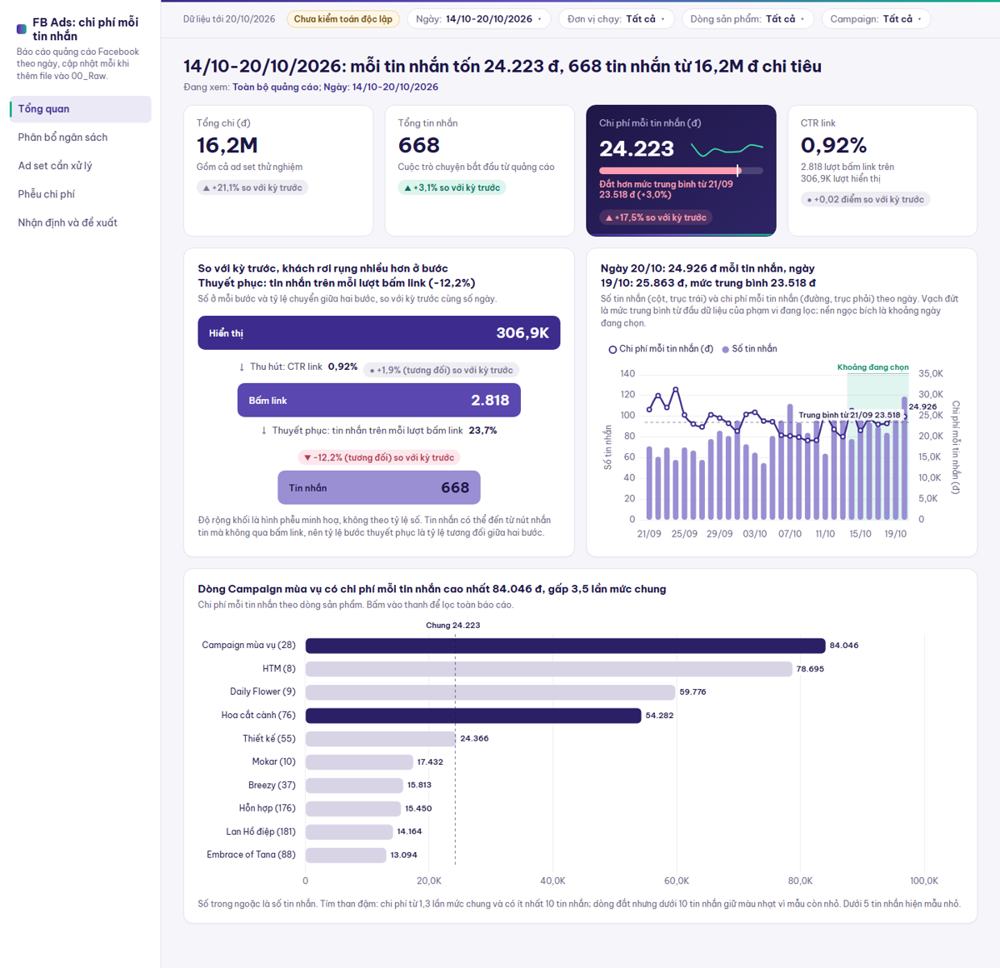

# Dashboard quảng cáo Facebook cùng Claude

Dự án thật: dùng **Claude Code** (ứng dụng desktop) để biến các file báo cáo Facebook Ads xuất hằng ngày thành một dashboard HTML tương tác. Dashboard giúp shop hoa quyết định mỗi ngày nên **dồn hay cắt ngân sách** quảng cáo ở đâu.

**Dashboard đang chạy:** https://fbads-dashboard.vercel.app

## Bối cảnh dữ liệu

**Doanh nghiệp:** một shop hoa bán qua Facebook. Shop chạy quảng cáo để khách **nhắn tin** hỏi mua; nhân viên chốt đơn trong tin nhắn chứ không qua website.

**Dữ liệu:** báo cáo hiệu quả quảng cáo Facebook, xuất từ Ads Manager mỗi ngày một file (`FB_Ads_Report_YYYY-MM-DD.xlsx`). Mỗi dòng là **một quảng cáo trong một ngày**, kèm vị trí của quảng cáo đó trong cây:
- **Campaign** (chiến dịch): tên campaign mã hoá đơn vị chạy và dòng sản phẩm, ví dụ `07_HEAD_Hoa cat canh` là dòng Hoa cắt cành do HEAD chạy. Đơn vị chạy gồm HEAD, Q2, Q7 và BR (thương hiệu). Dòng sản phẩm gồm Hoa cắt cành, Lan Hồ điệp, Thiết kế, Hỗn hợp, campaign mùa vụ (Trung thu)...
- **Ad set** (nhóm quảng cáo, thường là một tệp khách), ví dụ "Nữ văn phòng" hay "Retargeting".
- **Mục tiêu campaign:** Tin nhắn, Tương tác hoặc Tiếp cận.

| Nhóm cột | Cột trong file | Dashboard dùng |
|---|---|---|
| Chi phí | Spent (VND) | Có, là tử số của mọi chỉ số chi phí |
| Hiển thị | Impressions, Reach, Frequency, CPM | Lượt hiển thị và CPM tự tính lại từ tổng |
| Tương tác | Link clicks, CTR, CPC (All), Post comments | Lượt bấm link và CTR tự tính lại; bỏ CPC (All) |
| Kết quả | Messaging (số cuộc trò chuyện khách bắt đầu) | Có, là kết quả chính |
| Chuyển đổi | Conversions, Conversion values, Cost per conversion | Không, luôn bằng 0 |

**Quy mô ban đầu:** 30 ngày (21/09 tới 20/10/2026), 1.313 dòng, 17 campaign, 103 ad set; chi 58,4M đ, nhận 2.482 tin nhắn.

**Vì sao chỉ số chính là chi phí mỗi tin nhắn:** dữ liệu không có doanh thu hay đơn hàng (cột chuyển đổi luôn bằng 0), và tin nhắn là bước gần việc mua nhất mà dữ liệu ghi được. Vì vậy chỉ số chính là **chi phí mỗi tin nhắn** (tổng chi tiêu chia tổng tin nhắn), chỉ số phụ là số tin nhắn.
- **Vấn đề Claude tự tìm ra trước khi dựng:**
  - File "- Copy" trùng làm cộng đôi 2 ngày.
  - Cột Ad name không phải mã quảng cáo duy nhất, và bị Excel làm mất chữ số.
  - Campaign mục tiêu Tương tác vẫn mang về khoảng 19% số tin nhắn.

## Cấu trúc thư mục

```
.
├── README.md
├── refresh_dashboard.py        Làm mới dashboard bằng một lệnh (thêm --publish để đăng lên Vercel)
├── refresh_dashboard.bat       Bấm đúp để chạy trên Windows
├── scripts/
│   └── union_raw.py            Gộp các file báo cáo ngày thành một bảng, bỏ file trùng
├── work/
│   ├── etl_fb_ads_clean.py     Dựng bảng sạch theo luật làm sạch đã duyệt
│   ├── compute_cubes.py        Tính cube và số tổng cho dashboard
│   ├── mobile_shots.py         Chụp ảnh bản điện thoại để chấm giao diện
│   ├── 01_problem_brief.json   Người xem, quyết định, chỉ số chính, góc nhìn phân tích
│   ├── 02_cleaning_rules.json  Luật làm sạch viết bằng lời
│   ├── 02_data_contract.json   Định nghĩa từng chỉ số và cách tự kiểm
│   └── 03_dashboard_spec.json  Cấu hình dashboard: trang, biểu đồ, bộ lọc, công thức
├── deploy/
│   └── vercel.json             Cấu hình Vercel (chặn công cụ tìm kiếm lập chỉ mục)
└── docs/
    └── tong-quan.png           Ảnh trang Tổng quan dùng trong README
```

## Cách làm việc với Claude

**3 skill đã dùng:**

| Skill | Vai trò trong dự án |
|---|---|
| `dashboard-workflow` | Quy trình chính, từ hỏi bài toán, luật làm sạch, PRD để duyệt, tới build, kiểm số tự động, trang đề xuất và gói kiểm toán |
| `data:explore-data` | Chạy bằng subagent để khám phá dữ liệu thô bằng con mắt độc lập, tìm ra 17 vấn đề chất lượng trước khi dựng |
| `frontend-dashboard-review` | Chạy bằng subagent đóng vai critic: chỉ nhìn ảnh chụp để chấm giao diện và tư duy phân tích, 4 vòng |

Gói kiểm toán đã chuẩn bị sẵn cho skill thứ tư, `backend-dashboard-review`, để chạy ở một phiên riêng; skill này chưa chạy.

- **Bắt đầu từ quyết định, không phải biểu đồ.** Claude hỏi ai xem, cần quyết định gì, chỉ số chính, xem bao lâu một lần, rồi mới thiết kế.
- **Cách hiểu dữ liệu là việc của người dùng.** Chỗ nào có hai cách tính hợp lý ra số khác nhau, Claude tính cả hai rồi hỏi. Ví dụ, chi phí mỗi tin nhắn tính trên mọi campaign là 23.518 đ, chỉ tính campaign Tin nhắn là 18.680 đ. Mỗi lựa chọn thành một luật làm sạch viết bằng lời.
- **Duyệt trên giấy trước khi build.** Claude sinh PRD có thông điệp bằng số thật và công thức từng chỉ số. Người dùng sửa bố cục bằng phác thảo dạng bảng chữ, qua 4 phiên bản rồi mới duyệt.
- **Kiểm nhiều lớp, tách vai:**
  - Script so mọi con số trên màn hình với dữ liệu ở 161 trạng thái lọc.
  - Một subagent "critic" chỉ nhìn ảnh chụp để chấm giao diện, qua 4 vòng từ 5/10 lên 8/10.
  - Gói kiểm toán cho một phiên Claude riêng tự tính lại số từ dữ liệu thô.
- **Người dùng giữ quyền ở chỗ quan trọng.** Đồng ý điều khoản, đăng nhập Vercel, cho phép link công khai, chấp nhận lỗi còn lại: Claude dừng và chờ người dùng tự làm.
- **Làm thành quy trình lặp lại.** `refresh_dashboard.py` làm mới dashboard mỗi ngày bằng một lệnh, và dừng nếu dữ liệu có vấn đề.

## Bài học

1. Nói rõ người xem và quyết định; tránh yêu cầu chung chung kiểu "làm dashboard đẹp".
2. Phác thảo bố cục bằng một bảng chữ đơn giản là đủ để Claude hiểu.
3. Trả lời nghiêm túc câu hỏi định nghĩa: chênh lệch nhỏ trên giấy là chênh lệch thật trên ngân sách.
4. Không tin một lớp kiểm tra duy nhất. Lỗi thẻ KPI bị trống lọt qua kiểm số tự động (số vẫn đúng, chỉ vẽ sai chỗ), và chỉ critic nhìn ảnh mới bắt được.

## Dashboard



| Trang | Trả lời câu hỏi |
|---|---|
| Tổng quan | Mỗi tin nhắn tốn bao nhiêu, rẻ hay đắt hơn trung bình, khách rơi rụng ở bước nào |
| Phân bổ ngân sách | Tiền đổ vào đâu, nhóm và campaign nào nên dồn hay cắt |
| Ad set cần xử lý | Ad set nào cần tắt, cắt giảm, sửa nội dung hay dồn thêm |
| Phễu chi phí | Chi phí tăng do giá hiển thị (CPM) hay do quảng cáo kém hút tin nhắn |
| Nhận định và đề xuất | Nhận xét và hành động kèm số liệu làm căn cứ |

Bộ lọc: Ngày (mặc định 7 ngày gần nhất, so với kỳ trước), Đơn vị chạy, Dòng sản phẩm, Campaign.

## Kết quả dashboard

Số liệu tới 20/10/2026.

- **Tuần 14-20/10:** mỗi tin nhắn tốn **24.223 đ**, tăng 17,5% so với tuần trước. Nguyên nhân chính là quảng cáo kém hút tin nhắn hơn (giảm 10,5%); giá hiển thị (CPM) chỉ tăng 5,1%.
- **Toàn kỳ 30 ngày:** chi **58,4M**, nhận **2.482** tin nhắn, bình quân **23.518 đ** mỗi tin nhắn.
- **Phân bổ lệch:** Hoa cắt cành chiếm 25,5% ngân sách tuần nhưng chỉ ra 11,4% tin nhắn. Lan Hồ điệp ngược lại: 15,8% ngân sách, 27,1% tin nhắn.
- **Chỗ rò ngân sách:** nhóm ad set vừa tiêu nhiều vừa đắt giữ **23,2M** trên tổng 58,4M. Ad set không ra tin nhắn nào chỉ tốn 532K.
- **Đề xuất chính:**
  1. Tắt các ad set Trung thu đã qua mùa.
  2. Giảm ngân sách nhóm Cắt giảm.
  3. Dồn sang Hỗn hợp Q7, Lan Hồ điệp, Embrace of Tana, mỗi lần tăng không quá 20%.

**Chất lượng:**
- Số trên màn hình khớp dữ liệu ở 161 trạng thái lọc.
- Vòng chấm cuối đạt UI-UX 8/10, Tư duy phân tích 8/10.
- Chưa có kiểm toán độc lập.

## Xem dashboard trên Vercel

Mở **https://fbads-dashboard.vercel.app**, xem được trên máy tính và điện thoại.

- **Chuyển trang:** menu bên trái (trên điện thoại, menu nằm ở đầu trang).
- **Lọc:** dùng thanh bộ lọc trên cùng. Bộ lọc Ngày có các nút chọn nhanh 7 ngày, 14 ngày, tháng này, toàn bộ dữ liệu.
- **Lọc chéo:** bấm vào một thanh biểu đồ để lọc toàn báo cáo theo nhóm đó, bấm lại để bỏ.
- **Xem phễu một ad set:** ở trang Ad set cần xử lý, bấm một chấm trên ma trận.

Link công khai: ai có link đều xem được. Trang đã chặn công cụ tìm kiếm lập chỉ mục. Bản trên Vercel được cập nhật mỗi lần chạy `refresh_dashboard.py --publish`.

## Lưu trữ

| Nội dung | Nằm ở đâu |
|---|---|
| File báo cáo gốc, bảng sạch, dashboard có số liệu, PRD, gói kiểm toán, nhật ký QC | Máy chạy pipeline (thư mục dự án), không đưa lên GitHub |
| Dashboard để xem | Vercel, project `fbads-dashboard` (thư mục `deploy/` trên máy liên kết tới project này) |
| Code, file định nghĩa (luật làm sạch, chỉ số, cấu hình dashboard), tài liệu | Repo GitHub này |
| Runtime và script dựng dashboard | Skill `dashboard-workflow` của Claude Code, ngoài repo |

## Chạy lại

Cần có:
- Python với `pandas`, `openpyxl`, `playwright`;
- skill `dashboard-workflow` của Claude Code (không nằm trong repo; trỏ tới bằng biến `DASHBOARD_SKILL_DIR`);
- Node.js nếu muốn đăng lên Vercel.

Thả file báo cáo mới vào `00_Raw/`, rồi chạy:

```bash
python refresh_dashboard.py --publish
```

Lệnh này làm mới dashboard, kiểm tra, rồi đăng lên Vercel. Bỏ `--publish` nếu chỉ muốn làm mới trên máy.
